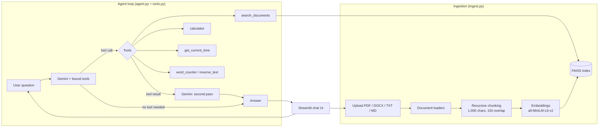

# RAG Agent with Tools

A document Q&A assistant that combines **Retrieval-Augmented Generation (RAG)** with **LLM tool calling**. Upload your own PDFs, Word documents, text or Markdown files and ask questions in a chat interface. The agent decides for each question whether to search your documents, use a tool, or answer from its own knowledge.

Built with **LangChain**, **Google Gemini 2.5**, **FAISS**, **Hugging Face embeddings** and **Streamlit**, and packaged in a **Dev Container** for one-click launch in GitHub Codespaces.

---

## Features

- **Multi-format ingestion:** PDF, DOCX, TXT and Markdown, with source-file metadata on every chunk
- **Semantic search:** sentence-transformer embeddings (`all-MiniLM-L6-v2`) in a persisted FAISS vector index
- **Tool-calling agent:** Gemini chooses between document search, a calculator, date/time lookup and text utilities
- **Grounded answers:** tool results are fed back to the model in a second pass, so answers are based on retrieved content
- **Reliability:** retry with back-off on API rate limits (HTTP 429) and a fallback when the model returns an empty response
- **Chat UI:** Streamlit interface with multi-document upload and on-demand re-indexing
- **One-click setup:** Python 3.11 Dev Container that installs dependencies and starts the app automatically

---

## Architecture



---

## How it works

**1. Ingestion (`ingest.py`)**
Each uploaded file is loaded with the matching LangChain loader (`PyPDFLoader`, `Docx2txtLoader`, `TextLoader`, `UnstructuredMarkdownLoader`) and tagged with its file name. Documents are split with `RecursiveCharacterTextSplitter` (1,000 characters, 150 overlap), embedded with `sentence-transformers/all-MiniLM-L6-v2`, and saved as a FAISS index.

**2. Tools (`tools.py`)**
Tools are defined with LangChain's `@tool` decorator. `search_documents` lazily loads the FAISS index and returns the top 3 most relevant chunks. The other tools handle arithmetic, the current date and time, and simple text operations.

**3. Agent (`agent.py`)**
Gemini (`gemini-2.5-flash-lite`) is bound to the tools with `bind_tools`. A system prompt sets routing rules: document questions always go to `search_documents` first, and general-knowledge questions are answered directly. If the model requests a tool, the tool runs and its result goes back to the model for a final, grounded answer. Rate-limit errors trigger an automatic wait and retry.

**4. Interface (`streamlit_app.py`)**
The sidebar handles document upload and rebuilds the index on demand. The chat shows which tool was used for each answer. If no documents are uploaded, the app indexes the bundled `data/sample.pdf`.

**Also included:** `app.py` is a command-line version of the RAG pipeline built with LangChain Expression Language (LCEL) and ChromaDB. It answers only from the retrieved context and lists the source pages for each answer.

---

## Tech stack

| Layer | Technology |
|---|---|
| LLM | Google Gemini 2.5 (via `langchain-google-genai`) |
| Orchestration | LangChain (tool calling, LCEL) |
| Embeddings | Hugging Face `sentence-transformers/all-MiniLM-L6-v2` |
| Vector stores | FAISS (agent), ChromaDB (CLI pipeline) |
| UI | Streamlit |
| Environment | Python 3.11 Dev Container, GitHub Codespaces |

---

## Project structure

```
rag-agent-with-tools/
├── streamlit_app.py   # Chat UI, document upload, re-indexing
├── agent.py           # Gemini + tool binding, agent loop, retries
├── tools.py           # search_documents, calculator, time, text tools
├── ingest.py          # Load, chunk, embed and index documents (FAISS)
├── app.py             # CLI RAG pipeline (LCEL + ChromaDB) with source citations
├── check_db.py        # Inspect the vector store
├── test_retrieval.py  # Test document search directly, without the LLM
├── llm.py             # Minimal Gemini connectivity test
├── data/sample.pdf    # Default document
├── requirements.txt
└── .devcontainer/     # Codespaces / Dev Container config
```

---

## Quick start

### Option 1: GitHub Codespaces (one click)
1. Click **Code → Codespaces → Create codespace on main**.
2. Add your Gemini API key as a Codespaces secret named `GOOGLE_API_KEY`.
3. The app starts automatically and opens on port 8501.

### Option 2: Run locally
```bash
git clone https://github.com/Neha2515416512/rag-agent-with-tools.git
cd rag-agent-with-tools
python -m venv venv
source venv/bin/activate        # Windows: venv\Scripts\activate
pip install -r requirements.txt
echo "GOOGLE_API_KEY=your_key_here" > .env
streamlit run streamlit_app.py
```

Get a free Gemini API key from [Google AI Studio](https://aistudio.google.com/).

---

## Example questions

- *"Summarise my document in five bullet points."* → uses `search_documents`
- *"What does the document say about pricing?"* → uses `search_documents`
- *"What is 15% of 2,340?"* → uses `calculator`
- *"What's today's date?"* → uses `get_current_time`

---

## Roadmap

- Replace `eval` in the calculator with a safe expression parser
- Add conversation memory across turns in the agent loop
- Add retrieval evaluation (faithfulness and answer relevance)
- Hybrid search (keyword + vector) and re-ranking

---

## Author

**Neha Gowda**, AI Engineer, Dublin
[LinkedIn](https://www.linkedin.com/in/nehagowda2001) · [GitHub](https://github.com/Neha2515416512)
